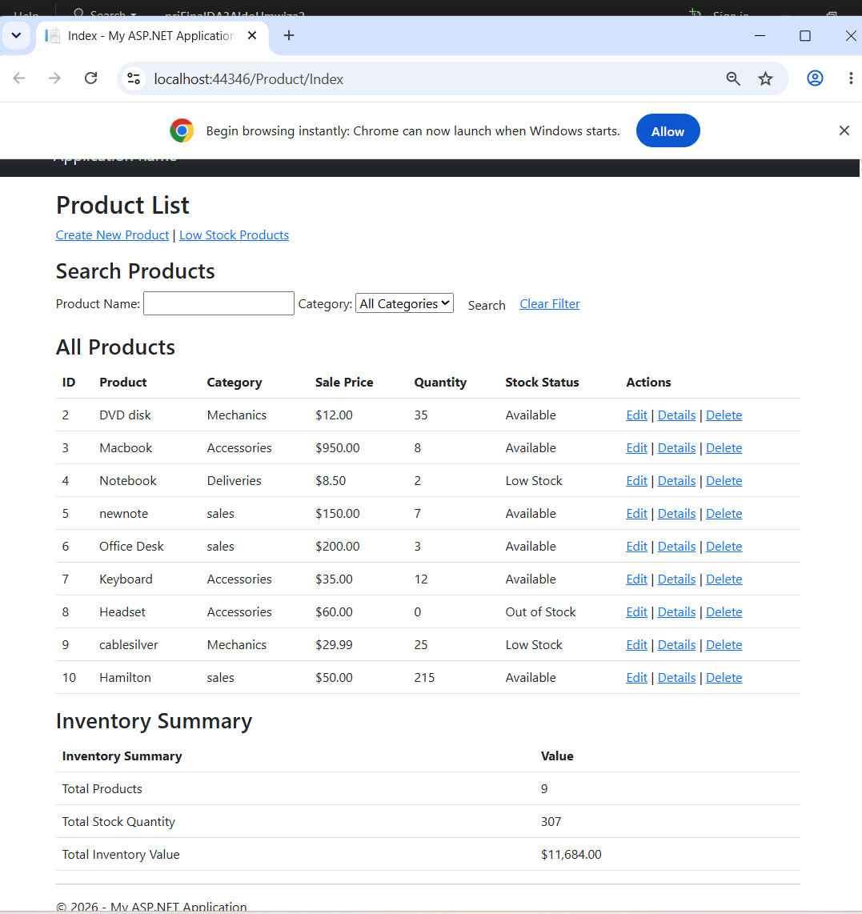
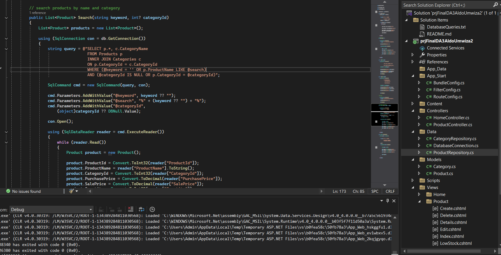
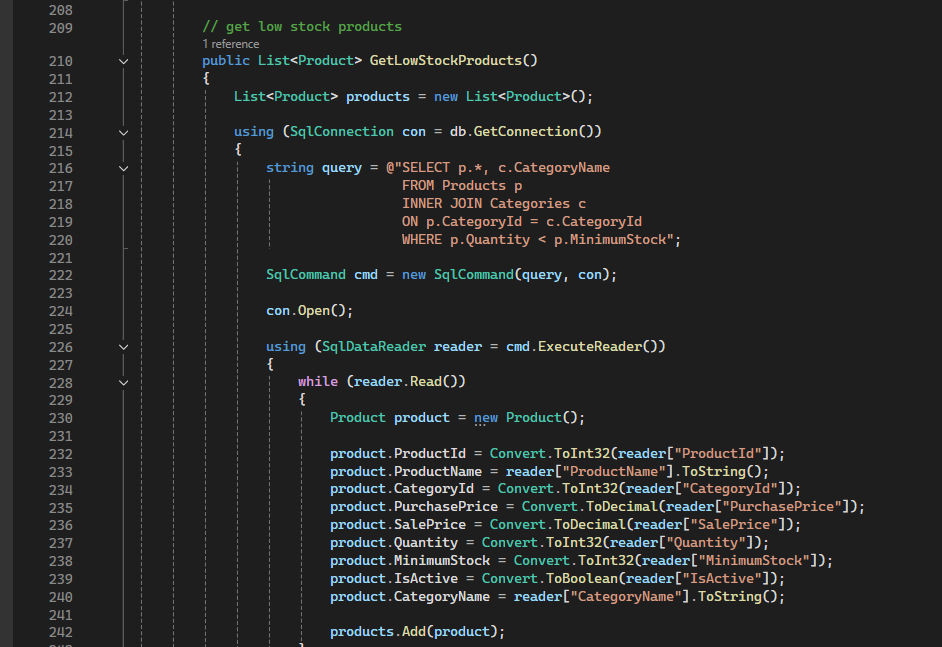
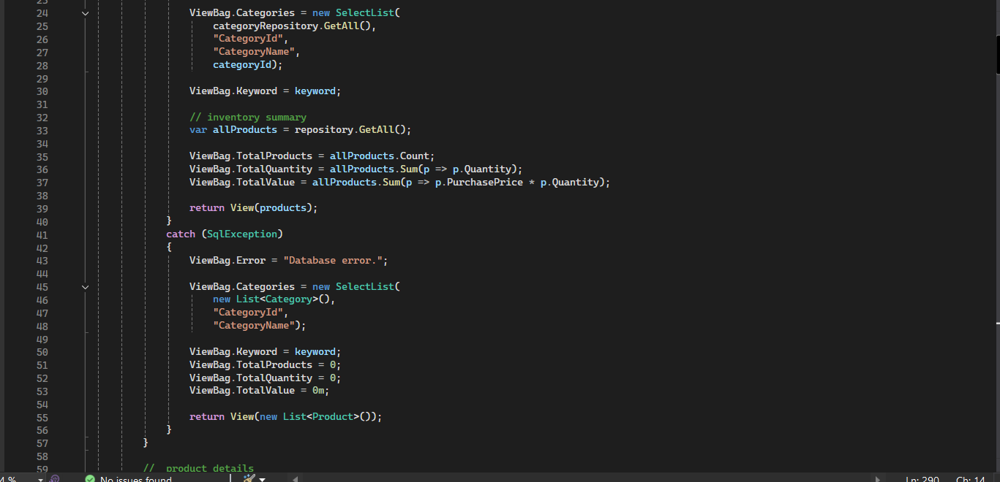

<div align="center">

# Inventory Management System

### ASP.NET MVC · C# · SQL Server

A practical, database-driven application for managing products, monitoring stock levels, and understanding inventory at a glance.

<br />


<br />

**Developed by [Aldo Umwiza](https://github.com/aldoumwiza)**  
Computer Programming · LaSalle College, Montréal

[**View source repository →**](https://github.com/aldoumwiza/ASP.NET-MVC-Project) · [**Back to my portfolio →**](https://github.com/aldoumwiza)

</div>

---

## Application preview

A look at the locally running application. The product screen includes keyword search, category filtering, stock status, product actions, and an inventory summary.

<div align="center">
  <a href="screenshots/dashboard.png">
    
  </a>
  <p><em>Product dashboard — select the image to view it full-size.</em></p>
</div>

---

## Project at a glance

| | |
| --- | --- |
| **Project type** | Academic ASP.NET MVC web application |
| **Language** | C# |
| **Framework** | ASP.NET MVC (.NET Framework) |
| **Database** | Microsoft SQL Server |
| **Data access** | ADO.NET with parameterized SQL queries |
| **Architecture** | Model–View–Controller with repository classes |
| **Development environment** | Visual Studio |

### What the application does

| Product management | Finding products | Stock visibility |
| :--- | :--- | :--- |
| Create, view, edit, and delete product records. | Search by product name and filter by category. | Display available, low-stock, and out-of-stock items. |

The dashboard also calculates **total product count**, **total stock quantity**, and **inventory value** based on product data. Product records are linked to categories in SQL Server.

---

## Behind the application

### 01 / Product search and category filtering

The repository uses a SQL `JOIN` to retrieve category names and parameterized queries to support a keyword and an optional category filter.

<div align="center">
  <a href="screenshots/search-filter.png">
    
  </a>
  <p><em>Search implementation · ProductRepository.cs</em></p>
</div>

### 02 / Low-stock monitoring

Products with a quantity below their configured minimum stock are selected using a SQL query. This supports a dedicated low-stock view.

<div align="center">
  <a href="screenshots/low-stock.png">
    
  </a>
  <p><em>Low-stock query · ProductRepository.cs</em></p>
</div>

### 03 / Inventory summary

The controller calculates product count, stock quantity, and inventory value from retrieved records, then passes the results to the view.

<div align="center">
  <a href="screenshots/inventory-summary.png">
    
  </a>
  <p><em>Dashboard totals · ProductController.cs</em></p>
</div>

---

## How it's structured

```text
prjFinalDA3AldoUmwiza2/
├── Controllers/        # HTTP actions and view coordination
├── Data/               # Product and category repositories; database connection
├── Models/             # Product and category data models
├── Views/              # Razor pages for product screens
├── Content/            # Stylesheets
├── Scripts/            # Client-side scripts
├── App_Start/          # MVC application configuration
└── Web.config          # Local app configuration (remove secrets before sharing)
```

The **Models** represent data, **Views** display it, **Controllers** handle requests, and the **Data** classes communicate with SQL Server.

## Run locally

This repository showcases a local ASP.NET MVC application; **it is not currently a hosted live demo**.

1. Install **Visual Studio** with ASP.NET/.NET Framework web development support and a compatible **SQL Server** instance.
2. Open `prjFinalDA3AldoUmwiza2.sln` in Visual Studio.
3. Create the database and tables with the project's SQL setup script (`DatabaseQueries.txt` if included). Review the script before running it.
4. Configure the `InventoryConnection` connection string in your local `Web.config` for your own SQL Server instance. **Never commit credentials or private configuration.**
5. Restore NuGet packages, build the solution, and run the application locally (for example with IIS Express).

> The repository should include the **extracted source files**, the solution, and a sanitized database setup script so reviewers can inspect the implementation without downloading a ZIP archive.

---

## What I practiced

C# and object-oriented programming · MVC architecture · SQL Server relationships · ADO.NET (`SqlConnection`, `SqlCommand`, `SqlDataReader`) · parameterized SQL · CRUD operations · input validation · product filtering · inventory reporting.

---

<div align="center">

### Let's connect

[](https://www.linkedin.com/in/umwiza-aldo-183542349/)
[](https://github.com/aldoumwiza)
[](mailto:aldo1umwiza@gmail.com)

*Built to learn. Documented to share.*

</div>
